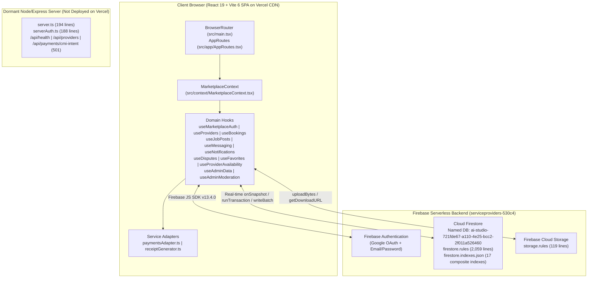

# 04 — ARCHITECTURE, ROUTING & DATABASE AUDIT
**Project:** Moul L'Khedma (مول الخدمة)  
**Audit Date:** 2026-11-23  
**Database Engine:** Google Cloud Firestore (Named Database: `ai-studio-721fde67-a110-4e25-bcc2-2f011a526460`) + Firebase Storage (`serviceproviders-530c4.firebasestorage.app`)

---

## 1. Actual System Architecture

### 1.1 Architecture Diagram

### 1.2 Architectural Layer Evaluation

| Layer | Implementation Files | Assessment |
|---|---|---|
| **Frontend Routing & Layouts** | `src/main.tsx`, `src/app/AppRoutes.tsx`, `src/app/layouts/PublicLayout.tsx`, `src/app/layouts/DashboardLayout.tsx`, `src/app/layouts/AdminLayout.tsx`, `src/app/guards/RouteGuards.tsx` | **Strong.** Single `BrowserRouter` at root, nested `<Outlet />` layouts, role-based guards (`RequireAuth`, `RequireVerifiedEmail`, `RequireRole`, `RequireAdmin`), and `?redirect=` query preservation. |
| **State Management & Domain Hooks** | `src/context/MarketplaceContext.tsx` + 10 domain hooks in `src/hooks/` | **Clean domain separation.** Hooks encapsulate Firestore queries, transactions, and optimistic state updates while `MarketplaceContext` composes them for UI consumption. |
| **Serverless Backend & Security Rules** | `firestore.rules` (`2,059` lines), `storage.rules` (`119` lines), `firestore.indexes.json` (`144` lines) | **Comprehensive schema validation** with a few contract mismatches (`AUD-001`, `AUD-002`, `AUD-003`, `AUD-004`, `AUD-005`, `AUD-007`) detailed below. |
| **Dormant Express API (`AUD-014`)** | `server.ts` (`194` lines), `serverAuth.ts` (`188` lines) | **Dead in production.** `vercel.json` serves `dist/` as a static SPA with `/(.*) -> /index.html` rewrites and does not mount `server.ts` as a Vercel Serverless Function. |

---

## 2. Routing Inventory & Stability Audit

### 2.1 Router Context & Stability Checklist
- **Single Router Provider:** Verified. `BrowserRouter` is instantiated exclusively in `src/main.tsx` (lines 16–20). No nested page or layout creates a second router.
- **Router Hook Context Safety:** All uses of `useLocation`, `useNavigate`, `Link`, and `NavLink` reside inside descendants of `<BrowserRouter>`.
- **SPA Deep-Link Refresh:** Verified in `vercel.json` (lines 43–48): `"rewrites": [{ "source": "/(.*)", "destination": "/index.html" }]`.
- **Auth Redirect Destination Preservation:** Verified in `src/app/guards/RouteGuards.tsx` (lines 37–41) and `src/pages/auth/LoginPage.tsx` (lines 20–24): unauthenticated accesses redirect to `/login?redirect=<encodedPath+search>`, and login returns the user to the preserved path.
- **404 Fallback:** Verified in `src/app/AppRoutes.tsx` (line 286): `<Route path="*" element={<NotFoundPage />} />`.

### 2.2 Complete Routing Inventory (29 Routes)

| # | Route Path | Component | Layout | Guard | Verification Status |
|---|---|---|---|---|---|
| 1 | `/` | `HomePage` | `PublicLayout` | Public | **Verified Working** |
| 2 | `/services` | `ServicesCatalogPage` | `PublicLayout` | Public | **Verified Working** |
| 3 | `/services/:categorySlug` | `CategoryLandingPage` | `PublicLayout` | Public | **Verified Working** |
| 4 | `/providers` | `ProvidersDirectoryPage` | `PublicLayout` | Public | **Verified Working** |
| 5 | `/providers/:providerId` | `ProviderPublicProfilePage` | `PublicLayout` | Public | **Verified Working** |
| 6 | `/cities/:citySlug` | `CityLandingPage` | `PublicLayout` | Public | **Verified Working** |
| 7 | `/cities/:citySlug/:categorySlug` | `CityCategoryLandingPage` | `PublicLayout` | Public | **Verified Working** |
| 8 | `/terms` | `TermsPage` | `PublicLayout` | Public | **Verified Working** |
| 9 | `/privacy` | `PrivacyPage` | `PublicLayout` | Public | **Verified Working** |
| 10 | `/login` | `LoginPage` | `PublicLayout` | Public (auto-redirects if signed in) | **Verified Working** |
| 11 | `/register` | `RegisterPage` | `PublicLayout` | Public | **Verified Working** |
| 12 | `/forgot-password` | `ForgotPasswordPage` | `PublicLayout` | Public | **Verified Working** |
| 13 | `/verify-email` | `VerifyEmailPage` | `PublicLayout` | `RequireAuth` | **Verified Working** |
| 14 | `/dashboard` | `RoleDashboardRedirect` | — | `RequireAuth` + `RequireVerifiedEmail` | **Verified Working** |
| 15 | `/customer/dashboard` | `CustomerDashboardPage` | `DashboardLayout` | `RequireRole(['client','both'])` | **Verified Working** |
| 16 | `/customer/requests` | `CustomerDashboardPage` (`tab=requests`) | `DashboardLayout` | `RequireRole(['client','both'])` | **Verified Working** |
| 17 | `/customer/bookings` | `CustomerDashboardPage` (`tab=bookings`) | `DashboardLayout` | `RequireRole(['client','both'])` | **Verified Working** |
| 18 | `/customer/favorites` | `CustomerDashboardPage` (`tab=favorites`) | `DashboardLayout` | `RequireRole(['client','both'])` | **Verified Working** |
| 19 | `/provider/dashboard` | `ProviderDashboardPage` | `DashboardLayout` | `RequireRole(['provider','both'])` | **Verified Working** |
| 20 | `/provider/leads` | `ProviderDashboardPage` (`tab=leads`) | `DashboardLayout` | `RequireRole(['provider','both'])` | **Verified Working** |
| 21 | `/provider/bookings` | `ProviderDashboardPage` (`tab=bookings`) | `DashboardLayout` | `RequireRole(['provider','both'])` | **Verified Working** |
| 22 | `/provider/Verification` | `ProviderDashboardPage` (`tab=verification`) | `DashboardLayout` | `RequireRole(['provider','both'])` | **Verified Working** (Note: path uses capital `V` `/provider/Verification` in `DashboardLayout.tsx` line 77 and `AppRoutes.tsx` line 231; case-insensitive matching works in React Router v7) |
| 23 | `/provider/earnings` | `ProviderDashboardPage` (`tab=earnings`) | `DashboardLayout` | `RequireRole(['provider','both'])` | **Verified Working** |
| 24 | `/profile` | `ProfileSettingsPage` | `DashboardLayout` | `RequireAuth` + `RequireVerifiedEmail` | **Verified Working** |
| 25 | `/messages` & `/messages/:bookingId` | `MessagesInboxPage` | `DashboardLayout` | `RequireAuth` + `RequireVerifiedEmail` | **Verified Working** |
| 26 | `/notifications` | `NotificationsPage` | `DashboardLayout` | `RequireAuth` + `RequireVerifiedEmail` | **Verified Working** |
| 27 | `/disputes` | `DisputesPage` | `DashboardLayout` | `RequireAuth` + `RequireVerifiedEmail` | **Verified Working** |
| 28 | `/admin` & `/admin/:section` (`overview`, `kyc`, `bookings`, `disputes`, `jobs`, `finance`, `users`, `reviews`, `audit`) | `AdminDashboardPage` | `AdminLayout` | `RequireAdmin` | **Verified Working** |
| 29 | `*` | `NotFoundPage` | `PublicLayout` | Public | **Verified Working** |

---

## 3. Code Quality, Duplication & Maintainability Audit

### 3.1 Duplicate & Legacy Modules (`AUD-014`)
1. **`src/components/ChatDrawerModal.tsx` (458 lines) vs. `src/pages/messages/MessagesInboxPage.tsx` (850 lines):**
   - `ChatDrawerModal` is still rendered via `src/components/modals/GlobalModals.tsx` (line 195) when clicking "Ouvrir le chat" on booking cards.
   - Because `ChatDrawerModal` writes only to `chats/{bookingId}/messages` and skips `updateConversationOnMessage` (`/conversations/{bookingId}`) and `dispatchUserNotification` (`/notifications`), messages sent in the drawer do not update the `/messages` inbox preview or unread counters (`AUD-008`).
2. **`src/components/ProviderDetailModal.tsx` (466 lines) vs. `src/pages/public/ProviderPublicProfilePage.tsx` (553 lines):**
   - Both components render a provider's bio, verified badge, portfolio gallery, reviews, and booking trigger.
3. **`server.ts` (194 lines) & `serverAuth.ts` (188 lines):**
   - Not mounted in `vercel.json`. Contains `/api/providers` serving static `VETTED_PROVIDERS` and `/api/payments/cmi-intent` returning HTTP `501`.

### 3.2 Oversized Monolithic Files (`AUD-014`)

| File Path | Line Count | Maintenance Risk |
|---|---:|---|
| `src/components/dashboards/ProviderDashboard.tsx` | `2,512` | Mixes overview metrics, KYC upload UI, portfolio editor, lead quoting modal, booking management, weekly calendar, and withdrawal modal in a single file. |
| `firestore.rules` | `2,059` | Monolithic rules file; well-commented, but complex nested boolean conditions increase risk of contract drift (`AUD-004`). |
| `src/data/marketplace.ts` | `1,636` | Combines TypeScript domain interfaces, 12 category definitions, neighborhood coordinate dictionaries, and dev fixture data (`VETTED_PROVIDERS`). |
| `src/components/dashboards/ClientDashboard.tsx` | `1,208` | Combines service request board, side-by-side quote comparison modal, booking management, and saved providers. |
| `src/hooks/useAdminData.ts` | `1,046` | Manages 7 concurrent admin listeners, pagination cursors, and fallback normalization in one hook. |
| `src/components/OnboardingModal.tsx` | `867` | Legacy modal wizard duplicating portions of `/register` and `/provider/Verification`. |
| `src/components/BookingModal.tsx` | `834` | Direct booking creation wizard with inline payment method selection and photo upload. |
| `src/components/Navbar.tsx` | `825` | Top navigation bar, auth drawers, language switcher, and notification dropdown. |

---

## 4. Database Architecture & Schema Audit

### 4.1 Complete Firestore Collections Inventory (17 Collections + 2 Subcollections)

| # | Collection Path | Purpose | Primary Writers | Primary Readers | Composite Indexes (`firestore.indexes.json`) |
|---|---|---|---|---|---|
| 1 | `/users/{uid}` | User identity, role (`client`, `provider`, `both`, `admin`), contact, `accountStatus`, `termsAcceptedAt` | Owner (`create`/`update`), Admin (`update`) | Owner (`get`), Admin (`get`/`list`) | — |
| 2 | `/providers/{uid}` | Public provider card, categories, neighborhoods, pricing, ratings, `verified`, `verificationStatus` | Owner (`create`/`update`), Admin (`update`), Client (rating transaction on review) | Public (`get`/`list`) | `verified ASC + rating DESC`; `city ASC + verified ASC + rating DESC` |
| 3 | `/providerDocuments/{uid}` | Private KYC vault (`cinFrontUrl`, `cinBackUrl`, `diplomaUrls`, `cinNumber`, `status`, `rejectionReason`) | Owner (`create`/`update` when not approved), Admin (`update`) | Owner (`get`), Admin (`get`/`list`) | `status ASC + submittedAt DESC` |
| 4 | `/providerAvailability/{uid}` | Weekly 7-day × 3-slot schedule (`weekly.monday.morning`, etc.) | Owner (`create`/`update`), Admin | Public (`get`) | — |
| 5 | `/scheduleLocks/{lockId}` | Deterministic slot lock (`{providerId}_{YYYY-MM-DD}_{slot}`) preventing double-booking | Authenticated Client/Provider (`create`), Participant/Admin (`delete`) | Authenticated (`get`/`list`) | — |
| 6 | `/bookings/{bookingId}` | Service bookings, status lifecycle, payment status, completion photos, review flags | Client (`create`/`update`), Provider (`update`), Admin (`update`) | Client (`clientId == uid`), Provider (`providerId == uid`), Admin | `clientId ASC + createdAt DESC`; `providerId ASC + createdAt DESC`; `providerId ASC + status ASC + createdAt DESC` |
| 7 | `/bookings/{bookingId}/reviews/{reviewId}` | Deterministic (`main`) post-completion customer review + provider reply | Client (`create` via transaction), Provider (`update` reply), Admin (`delete`) | Public (`get`/`list`) | Collection group `reviews`: `providerId ASC + createdAt DESC` |
| 8 | `/chats/{bookingId}/messages/{messageId}` | Real-time booking thread messages (text + optional image) | Booking Client/Provider/Admin (`create`), Recipient (`update` `readBy`) | Booking Client/Provider/Admin (`get`/`list`) | — |
| 9 | `/conversations/{bookingId}` | Denormalized inbox metadata (`participantIds`, `lastMessageText`, `unreadCountByUser`) | Booking Client/Provider/Admin (`create`/`update`) | Participant (` participantIds array-contains uid`), Admin | `participantIds CONTAINS + lastMessageAt DESC` |
| 10 | `/notifications/{notificationId}` | In-app notifications (`booking_created`, `quote_received`, `message_received`, `kyc_updated`, etc.) | Actor (`create`), Recipient (`update` `read`), Admin | Recipient (`userId == uid`), Admin | `userId ASC + createdAt DESC`; `userId ASC + read ASC + createdAt DESC` |
| 11 | `/jobPosts/{jobId}` | Customer public service requests (`open`, `assigned`, `completed`, `cancelled`) | Client (`create`/`update`), Provider (`update` `proposalCount` increment), Admin | Public (`get`/`list`) | `status ASC + createdAt DESC`; `city ASC + status ASC + createdAt DESC`; `clientId ASC + createdAt DESC` |
| 12 | `/jobPosts/{jobId}/proposals/{proposalId}` | Deterministic (`{providerId}`) itemized provider quotations | Provider (`create`/`update` withdraw), Job Client (`update` accept/reject), Admin | Proposal Provider, Job Client, Admin | — |
| 13 | `/withdrawals/{withdrawalId}` | Provider payout requests (`pending`, `approved`, `settled`, `rejected`) | Provider (`create`), Admin (`update`) | Provider (`providerId == uid`), Admin | `providerId ASC + createdAt DESC` |
| 14 | `/disputes/{disputeId}` | Booking disputes (`open`, `under_review`, `resolved_refund`, `resolved_release`, `dismissed`) | Booking Client/Provider (`create`), Admin (`update`) | Opener (`openedByUid == uid`), Counterparty (`counterpartyUid == uid`), Admin | `openedByUid ASC + createdAt DESC`; `status ASC + createdAt DESC` |
| 15 | `/favorites/{favoriteId}` | Deterministic (`{userId}_{providerId}`) saved providers | Owner (`create`/`delete`) | Owner (`userId == uid`) | `userId ASC + createdAt DESC` |
| 16 | `/reports/{reportId}` | Review/content moderation reports (`open`, `resolved`, `dismissed`) | Reporter (`create`), Admin (`update`) | Reporter (`reporterUid == uid`), Admin | `status ASC + createdAt DESC` |
| 17 | `/adminAuditLogs/{logId}` | Immutable append-only administrative & CNDP access audit trail | Admin (`create`; `update`/`delete` permanently `false`) | Admin (`get`/`list`) | — |
| 18 | `/payments/{paymentId}` | Reserved server-only payment ledger (`allow create, update, delete: if false`) | None (Dormant) | Owner/Admin | — |
| 19 | `/refunds/{refundId}` | Reserved server-only refund ledger (`allow create, update, delete: if false`) | None (Dormant) | Owner/Admin | — |

### 4.2 Transaction Boundaries & Atomicity Audit

| Workflow | Transaction / Batch Implementation | Atomicity Verdict |
|---|---|---|
| **Profile & Provider Card Save** | `writeBatch` across `/users/{uid}` and `/providers/{uid}` (`useMarketplaceAuth.ts` lines 555–612) | **Defect (`AUD-004`):** Uses `{ merge: false }` without preserving `accountStatus` or `termsAcceptedAt`, causing `PERMISSION_DENIED` if either field exists on `/users/{uid}`. Also includes `completedJobs` on `/providers/{uid}` update which fails `firestore.rules` line 633 if `completedJobs` was not previously present on `/providers/{uid}`. |
| **Provider Proposal Submission** | `runTransaction` reading `/jobPosts/{jobId}` and `/jobPosts/{jobId}/proposals/{providerId}`, creating proposal and incrementing `proposalCount` (`useJobPosts.ts` lines 407–481) | **Defect (`AUD-007`):** Because `proposalId` is `{providerId}` and `firestore.rules` line 1264 requires `!exists(.../proposals/$(request.auth.uid))`, a provider who withdraws a proposal can never re-submit or update the price. |
| **Customer Proposal Acceptance** | `runTransaction` reading `/jobPosts/{jobId}`, `/proposals/{proposalId}`, and `/scheduleLocks/{lockId}`, then writing lock, booking, proposal (`accepted`), and job (`assigned`) (`useJobPosts.ts` lines 539–591) | **Atomic for winner**, but leaves competing proposals in `'pending'` status (`AUD-013`). |
| **Direct Booking Creation** | `addDoc(collection(db, 'bookings'), ...)` (`useBookings.ts` line 299) | **Defect (`AUD-006`):** Does not check `/providerAvailability/{uid}` and does not create `/scheduleLocks/{lockId}` in a transaction. |
| **Booking Cancellation** | `updateDoc(doc(db, 'bookings', bookingId), ...)` (`useBookings.ts` lines 473–479) | **Defect (`AUD-006`):** Does not delete any `/scheduleLocks/{lockId}` associated with the cancelled booking, permanently locking that slot. |
| **Customer Review Submission** | `runTransaction` creating `/bookings/{id}/reviews/main`, marking `booking.reviewed = true`, and recalculating `/providers/{providerId}` `rating` & `reviewsCount` (`useBookings.ts` lines 649–709) | **Verified Atomic & Working.** |
| **Admin KYC Approval / Rejection** | `writeBatch` updating `/providerDocuments/{uid}`, `/providers/{uid}`, and appending `/adminAuditLogs/{logId}` (`useAdminModeration.ts` lines 163–211) | **Verified Atomic & Working.** |
| **Admin Dispute Resolution** | `writeBatch` updating `/disputes/{disputeId}`, `/bookings/{bookingId}`, and appending `/adminAuditLogs/{logId}` (`useAdminModeration.ts` lines 318–361) | **Verified Atomic & Working.** |
